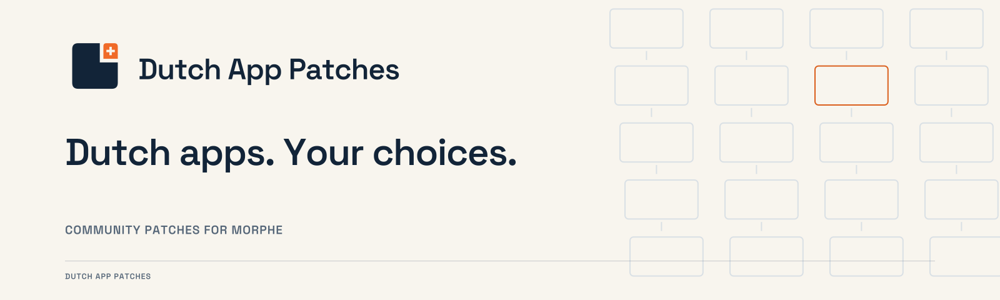

  <picture>
    <source media="(prefers-color-scheme: dark)" srcset="docs/site/assets/brand/readme-dark.png">
    
  </picture>

  

Open the button on your Android device to add this patch source to Morphe Manager.

# Dutch App Patches

Community patches for Dutch Android apps, compatible with Morphe. Choose which
ads, tracking and prompts to remove, and read what each patch changes in the
[Dutch guide](https://johninnl.github.io/nl-morphe-patches/) or
[English guide](https://johninnl.github.io/nl-morphe-patches/en/).
Independently maintained; not affiliated with Morphe or the app publishers.

Installable bundles are listed on the
[releases page](https://github.com/johninnl/nl-morphe-patches/releases).
All app targets listed below belong to the production patch set.

## Get started

1. Install [Morphe Manager](https://morphe.software/).
2. Check your app's guide for the supported version and original download.
3. Open [Add to Morphe](https://morphe.software/add-source?github=johninnl/nl-morphe-patches)
   on your Android device, then choose your patches in Manager and apply them
   to the original app file.

The [installation guide](docs/site/en/guides/install.md) explains updates and
signing. Some patches change notifications or other app features; review the
app page before choosing them. A tracking patch reduces the listed tracking;
it does not guarantee anonymity or remove all network traffic.

## App overview

<!-- PATCHES_START SUMMARY -->
**Patch bundle [v1.0.1](https://github.com/johninnl/nl-morphe-patches/releases/tag/v1.0.1)** · 38 apps · 158 patches

### Weather

| App | Changes | Target app versions | Input | Patches |
| --- | --- | --- | --- | --- |
| [Buienalarm](https://johninnl.github.io/nl-morphe-patches/apps/buienalarm/) | Ads · Tracking · Prompts · Compatibility | 4.32.0 | APKS | 5 |
| [Buienradar](https://johninnl.github.io/nl-morphe-patches/apps/buienradar/) | Ads · Tracking · Prompts | 7.4.8 | APKM | 5 |
| [Weeronline](https://johninnl.github.io/nl-morphe-patches/apps/weeronline/) | Ads · Tracking · Prompts · Plus/Pro | 3.61.0 | APKS | 5 |
| [Weerplaza](https://johninnl.github.io/nl-morphe-patches/apps/weerplaza/) | Ads · Tracking · Prompts · Compatibility | 3.13.1 | APKS | 5 |

### News and reading

| App | Changes | Target app versions | Input | Patches |
| --- | --- | --- | --- | --- |
| [AD](https://johninnl.github.io/nl-morphe-patches/apps/ad/) | Ads · Tracking · Prompts · Articles | 9.22.0 | APKS | 5 |
| [Bright](https://johninnl.github.io/nl-morphe-patches/apps/bright/) | Ads · Tracking · Prompts · Articles | 10.181.0 | APKS | 4 |
| [De Morgen](https://johninnl.github.io/nl-morphe-patches/apps/demorgen/) | Ads · Tracking · Prompts · Articles | 7.53.1 | APKS | 5 |
| [De Tijd](https://johninnl.github.io/nl-morphe-patches/apps/detijd/) | Ads · Tracking · Prompts · Articles | 5.6.1 | APKS | 7 |
| [DS Nieuws](https://johninnl.github.io/nl-morphe-patches/apps/dsnieuws/) | Ads · Tracking · Prompts | 22.0.0 | APKS | 4 |
| [FTM](https://johninnl.github.io/nl-morphe-patches/apps/ftm/) | Ads · Tracking · Prompts · Articles | 2.6.8 | APKS | 5 |
| [HBVL](https://johninnl.github.io/nl-morphe-patches/apps/hbvl/) | Ads · Tracking · Prompts | 22.0.0 | APKS | 4 |
| [HLN](https://johninnl.github.io/nl-morphe-patches/apps/hln/) | Ads · Tracking · Prompts · Articles | 9.22.0 | APKS | 5 |
| [Humo](https://johninnl.github.io/nl-morphe-patches/apps/humo/) | Ads · Tracking · Prompts · Articles | 7.53.1 | APKS | 5 |
| [Medium](https://johninnl.github.io/nl-morphe-patches/apps/medium/) | Tracking · Prompts · Articles | 4.5.1784911033 | APKS | 3 |
| [Nieuwsblad](https://johninnl.github.io/nl-morphe-patches/apps/nieuwsblad/) | Ads · Tracking · Prompts | 22.0.0 | APKS | 4 |
| [NOS Teletekst](https://johninnl.github.io/nl-morphe-patches/apps/nos-teletekst/) | Tracking | 2.8.10 | APKS | 2 |
| [NRC](https://johninnl.github.io/nl-morphe-patches/apps/nrc/) | Ads · Tracking · Prompts · Articles · Newspaper tab | 5.12.24 | APK | 6 |
| [NU.nl](https://johninnl.github.io/nl-morphe-patches/apps/nunl/) | Ads · Tracking · Prompts | 26.9.0 | APKS | 4 |
| [Omroep Brabant](https://johninnl.github.io/nl-morphe-patches/apps/omroep-brabant/) | Ads · Tracking · Prompts | 11.1.0 | APKS | 3 |
| [Omroep West](https://johninnl.github.io/nl-morphe-patches/apps/omroep-west/) | Ads · Tracking · Prompts | 20.1 | APKS | 3 |
| [Parool](https://johninnl.github.io/nl-morphe-patches/apps/parool/) | Ads · Tracking · Prompts · Articles | 7.53.1 | APKS | 5 |
| [RTL Nieuws](https://johninnl.github.io/nl-morphe-patches/apps/rtl-nieuws/) | Ads · Tracking · Prompts | 12.7.1 | APKS | 4 |
| [Trouw](https://johninnl.github.io/nl-morphe-patches/apps/trouw/) | Ads · Tracking · Prompts · Articles | 7.53.1 | APKS | 5 |
| [Tubantia](https://johninnl.github.io/nl-morphe-patches/apps/tubantia/) | Ads · Tracking · Prompts · Articles | 9.23.2 | APKS | 5 |
| [Voetbal International](https://johninnl.github.io/nl-morphe-patches/apps/voetbal-international/) | Ads · Tracking · Prompts · Articles | 5.13.52 | APKS | 4 |
| [Volkskrant](https://johninnl.github.io/nl-morphe-patches/apps/volkskrant/) | Ads · Tracking · Prompts · Articles | 7.53.1 | APKS | 5 |

### Traffic and navigation

| App | Changes | Target app versions | Input | Patches |
| --- | --- | --- | --- | --- |
| [9292](https://johninnl.github.io/nl-morphe-patches/apps/9292/) | Ads · Tracking · Prompts · Compatibility | 2.48.1 | APKM | 4 |
| [Flitsmeister](https://johninnl.github.io/nl-morphe-patches/apps/flitsmeister/) | Ads · Tracking · Prompts · Plus/Pro · Compatibility · Partner services | 14.17 | APKS | 6 |

### Entertainment

| App | Changes | Target app versions | Input | Patches |
| --- | --- | --- | --- | --- |
| [Dumpert](https://johninnl.github.io/nl-morphe-patches/apps/dumpert/) | Ads · Tracking · Prompts | 5.8.0 | APKS | 3 |
| [KIJK Android](https://johninnl.github.io/nl-morphe-patches/apps/kijk/) | Ads · Tracking · Prompts | 9.8.0 | APK | 3 |
| [KIJK Android TV](https://johninnl.github.io/nl-morphe-patches/apps/kijk-android-tv/) | Ads · Tracking | 7.2.7 | APKS | 3 |
| [NPO Start](https://johninnl.github.io/nl-morphe-patches/apps/npo-start/) | Ads · Tracking · Compatibility | 1.48.2-2405 | APKS | 3 |
| [NPO Start Android TV](https://johninnl.github.io/nl-morphe-patches/apps/npo-start-android-tv/) | Ads · Tracking · Compatibility | 1.48.2-2405 | APKS | 3 |
| [Podimo](https://johninnl.github.io/nl-morphe-patches/apps/podimo/) | Plus/Pro | 3.5.1 | APKS | 2 |
| [TVgids.nl](https://johninnl.github.io/nl-morphe-patches/apps/tvgids-nl/) | Ads · Tracking · Prompts | 7.0.16 | APK | 3 |
| [Videoland Android](https://johninnl.github.io/nl-morphe-patches/apps/videoland/) | Ads · Tracking · Prompts | 1.116.4 | APKS | 3 |
| [Videoland Android TV](https://johninnl.github.io/nl-morphe-patches/apps/videoland-android-tv/) | Ads · Tracking | 1.117.0 | APKS | 3 |

### Other apps

| App | Changes | Target app versions | Input | Patches |
| --- | --- | --- | --- | --- |
| [Marktplaats](https://johninnl.github.io/nl-morphe-patches/apps/marktplaats/) | Ads · Tracking · Prompts | 16.17.0, 16.19.0 | APKM | 5 |

[Patch defaults and supported versions](https://johninnl.github.io/nl-morphe-patches/reference/catalogue/) · [English](https://johninnl.github.io/nl-morphe-patches/en/reference/catalogue/)

Targets and defaults vary by patch; the bundle version is separate from each app version.
<!-- PATCHES_END -->

App pages describe patch effects, supported versions, defaults and relevant
limits. Advertising and tracking services are listed where useful.

## Develop and contribute

See [CONTRIBUTING.md](CONTRIBUTING.md) for build requirements, app verification
and documentation checks. [Report an issue](https://github.com/johninnl/nl-morphe-patches/issues)
with the app version, selected patches and reproducible steps.

Code is licensed under [GPLv3](LICENSE). Retained contributor and upstream
credit is in [AUTHORS.md](AUTHORS.md) and [NOTICE](NOTICE). Brand and font
attribution is in [asset sources](docs/site/assets/brand/SOURCES.md).
